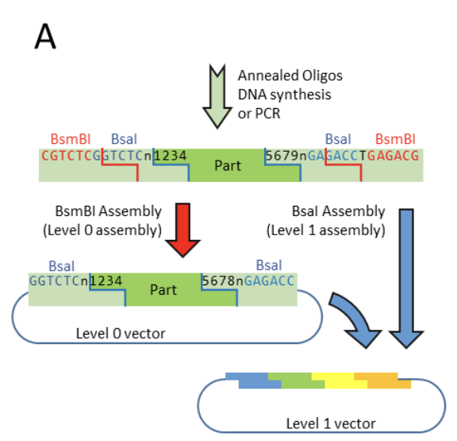

# 20.A04-Cloning

## Papers
- MoClo and Golden Gate, the original papers
    - [A One Pot, One Step, Precision Cloning Method with High Throughput Capability (Golden Gate)](https://pmc.ncbi.nlm.nih.gov/articles/PMC2574415/)
    - [A Modular Cloning System for Standardized Assembly of Multigene Constructs (MoClo)](https://pmc.ncbi.nlm.nih.gov/articles/PMC3041749/)
- MoClo system we will be using
    - [Joint universal modular plasmids (JUMP): a flexible vector platform for synthetic biology](https://academic.oup.com/synbio/article/6/1/ysab003/6126375)

## Software
- SnapGene (plasmid viewer and editor): https://ist.mit.edu/gsl/snapgene
- pLannotate (automatic annotation of plasmids): https://plannotate.barricklab.org/

## Plasmids
- pJUMP18-Uac (Universal part acceptor) (Addgene): https://www.addgene.org/126959/

## Creating a MoClo kit part

### JUMP overhangs

<table>
    <tr>
        <th>Part type</th>
        <th>5' overhang</th>
        <th>3' overhang</th>
    </tr>
    <tr>
        <td>A</td>
        <td>GGAG</td>
        <td>AATG</td>
    </tr>
    <tr>
        <td>B</td>
        <td>AATG</td>
        <td>AGCC</td>
    </tr>
    <tr>
        <td>C</td>
        <td>AGCC</td>
        <td>TTCG</td>
    </tr>
    <tr>
        <td>D</td>
        <td>TTCG</td>
        <td>CGCT</td>
    </tr>
</table>

### BsmBI and BsaI cut sites

### Example: IL11 as a Type "C" part

1. **Find a source of the IL11 gene**.
    - Luckily, there is an existing plasmid on Addgene (https://www.addgene.org/189609/) that includes the IL11 gene.
    - If there wasn't, we'd need to look for the sequence itself, and have it chemically synthesized (either by [Twist](https://www.twistbioscience.com/) or [IDT](https://www.idtdna.com/page)).
        - NCBI Gene - IL11: https://www.ncbi.nlm.nih.gov/gene/3589
        - Consensus sequence: https://www.ncbi.nlm.nih.gov/CCDS/CcdsBrowse.cgi?REQUEST=CCDS&DATA=CCDS12923.1
2. Design the PCR reaction(s) to amplify your sequence of interest. See [`pJUMP18-Uac PCR primer design.pdf`](./pJUMP18-Uac%20PCR%20primer%20design.pdf) for reference.

### Compiling a list of parts

- Name
- Description/purpose
- Part type (promoter, 5' miRNA, CDS, 3' miRNA, terminator, etc.)
- Source/sequence
- at a later point: forward primer(s), reverse primer(s)

#### Example: an immunology toolkit

<table>
    <tr>
        <th>Name</th>
        <th>Description</th>
        <th>Part type</th>
        <th>Source</th>
    </tr>
    <tr>
        <td>IL11</td>
        <td>cytokine </td>
        <td>CDS</td>
        <td>https://www.addgene.org/189609/</td>
    </tr>
    <tr>
        <td>IL11Rα</td>
        <td>IL11 receptor, alpha subunit</td>
        <td>CDS</td>
        <td>https://www.addgene.org/156788/</td>
    </tr>
    <tr>
        <td>IL11Rβ (gp130)</td>
        <td>IL11 receptor, beta subunit</td>
        <td>CDS</td>
        <td>https://www.addgene.org/254107/</td>
    </tr>
</table>

## Writeup

For your writeup, you should include at least the following information:

1. **Overview** — Introduce the project. What is it? What is MoClo? Why is MoClo a key part of synbio?
2. **Motivation** — Why are you interested in this topic area? What are the questions you want to explore? What solutions are you trying to build?
3. **Parts list** (≥5 parts) — For each part, include the following info:
    - Description
    - Purpose/reason
    - Sequence
    - Source (e.g. Addgene link, NCBI link)
4. **Progress log** — Record the progress you made on your MoClo kit, including the brainstorming, part search and selection, primer design, miniprep, assembly, sequence verification, etc.
5. **Appendix 1: MoClo tutorial** — Explain MoClo in general, and the JUMP MoClo system in particular.

## Other references

- New parts
    - [Binding and sensing diverse small molecules using shape-complementary pseudocycles](https://pmc.ncbi.nlm.nih.gov/articles/PMC11542606)